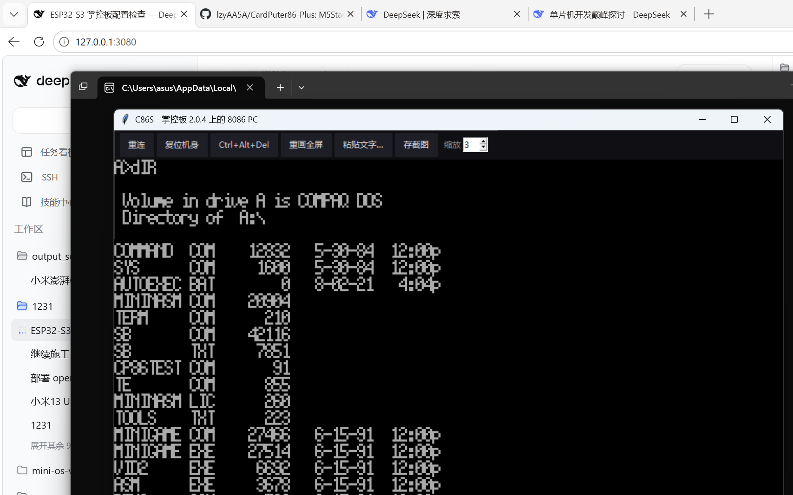

# C86S — A DOS emulator for plain ESP32 (video over serial)

> [中文](README.md) | **English**

Run an **8086 PC and MS-DOS** on a bare **ESP32** (掌控板 2.0.4 / ESP32-D0WDQ6 / 8 MB flash /
no PSRAM / no screen). The board only runs the CPU, memory and peripherals; **video is streamed
out over UART** and keyboard input comes back over the same wire. One PC-side window acts as the
monitor, so plugging in USB gives you a ~4.77 MHz PC/XT.

```
   ┌────────────────────┐   UART0 921600 (CP2104)   ┌──────────────────────┐
   │  ESP32 board       │ ─────  video (RLE) ─────► │  tools/c86host.py    │
   │  ESP32-D0WDQ6      │ ◄────  scan codes  ────── │  320x200 + keyboard  │
   │  8MB GD25Q64       │                           │  + status bar        │
   └────────────────────┘                           └──────────────────────┘
```



## What this is

C86S is a **port** of [CardPuter86](https://github.com/Clearwavelet/CardPuter86). The emulator
core keeps its Fake86 lineage (see [License](#license-and-provenance)); what was rewritten is the
**machine layer** — the M5GFX display, Cardputer key matrix, FatFS image and I2S speaker became
serial video, PS/2 scan codes, a raw flash partition and BEEP frames.

| Before (Cardputer / ESP32-S3) | Now (bare ESP32) |
| --- | --- |
| LGFX sprite → ST7789 240x135 | 4bpp packing + per-line RLE → UART0 |
| Cardputer key matrix | PS/2 set-1 scan codes from the PC → emulated 8042 |
| IMG file on FatFS + wear levelling | a raw flash partition used as the disk (no filesystem) |
| I2S speaker | BEEP frames, played on the PC |
| Settings menu on the TFT | buttons in the PC-side window |

The payoff is direct: dropping M5GFX / WiFi / BLE takes the **firmware from 2.0 MB down to 403 KB
with 96 KB of static RAM**, and everything saved goes to the guest RAM page cache.

## Measured numbers

Test setup: 掌控板 2.0.4 (ESP32-D0WDQ6 V3 / 8 MB GD25Q64 / 240 MHz / no PSRAM), COM3 @ 921600.

| Item | Measured |
| --- | --- |
| Firmware size | 403,381 B (12.8% of the 3 MB app partition; 403,773 B when rebuilt from this repo) |
| Static RAM | 96,040 B (29.3% of 320 KB) |
| Guest RAM | 256 KB (64 pages, 32 resident in the cache, the rest paged to flash) |
| Boot (reset → `A:\>`) | **24.3 s** (12 s POST memory test + 8 s DOS 5.0 boot) |
| Throughput | **~270k instructions/s** (5.6 ms per 2000-instruction batch, ≈672 cycles each) |
| Full text screen frame | 32,000 B raw → 6.9 KB (4bpp + RLE) |

The missing PSRAM is the board's hard constraint: 256 KB of guest RAM is split into 64 pages of
4 KB, the resident page cache only holds 32, and every eviction costs an erase + 4 KB write
(~48 ms). **The slow part of boot is paging, not emulation.** Dropping guest RAM to 128 KB
(`-DG86_FORCE_RAMKB=256` → `128`) removes the paging entirely and gets boot into the 5-second
range — but DOS 5.0 wants 256 KB, so it is a speed/system trade-off, not a bug.

## Quick start

You need a Windows PC, PlatformIO, and **a DOS floppy image of your own** (see
[About system disk images](#about-system-disk-images)).

```powershell
# 1. build
pio run -e c86s

# 2. flash (backs up the whole chip first, erases the swap partition, writes
#    bootloader/partition table/firmware/system disk, then hard-resets)
.\flash.ps1 -Port COM3

# 3. open the window (PC-side monitor + keyboard)
python tools\c86host.py --port COM3 --scale 3
```

Prefer a GUI? Double-click `start-c86s.cmd`; it launches `tools/c86mgr.py` with one-click start,
one-click flashing and a virtual floppy editor.

In the window: buttons on top (reconnect / reset board / Ctrl+Alt+Del / repaint / paste text /
save screenshot / zoom 1-4x), the 320x200 screen in the middle, board log below it, and a status
bar at the bottom (fps, guest RAM, heap, TEXT/GFX mode, dropped and corrupt frames).

**The PC side needs no Python packages at all**: serial goes through `ctypes` and the Win32 API,
video through tkinter plus a hand-rolled PNG writer (zlib is standard library). It works even on
machines where `pip install` keeps failing.

### Swapping the system disk

The system disk is just a raw-sector partition (`disk` @ `0x600000`, 2 MB). Swapping it means
writing another image there:

```powershell
esptool --port COM3 --baud 921600 write-flash 0x600000 data\cardputer86.img
```

Geometry (sectors per track, heads, bytes per sector) is read from the image's own BPB, so
**no code change is needed**: a 360 KB image runs as 40/2/9 and a 1.44 MB image as 80/2/18.

## Hardware and partitions

The app partition is 3 MB because the emulator compiles roughly 1 MB of BIOS / video ROM / font
data into `.rodata`.

```
# name,     type, subtype,  offset,   size,     flags
nvs,        data, nvs,      0x9000,   0x5000,
otadata,    data, ota,      0xE000,   0x2000,
app0,       app,  factory,  0x10000,  0x300000,
swap,       data, 0x40,     0x310000, 0x90000,
disk,       data, 0x99,     0x600000, 0x200000,
```

`0x3A0000`-`0x600000` is deliberately left unpartitioned: that region holds a GUIX resource blob
from the stock firmware, it does not belong to this project, and **it is not touched**.
`swap` is the guest RAM backing store; `disk` is the system disk.

**Flash mode must be DIO.** With QIO this board falls into a `rst:0x7 (TG0WDT_SYS_RST)` black-screen
loop; `platformio.ini` already pins DIO.

## Serial protocol

One UART, bidirectional, 921600 8N1:

* **Board → PC**: a 4bpp-packed 320x200 frame, **RLE per scanline** (`<0x80` literal run,
  `>=0x80` repeat run), with a second dedup layer per line (refresh generation + content
  signature) so unchanged lines cost zero bytes.
* **PC → board**: PS/2 set-1 make/break scan codes fed to an emulated 8042 keyboard controller,
  plus control commands (reset, Ctrl+Alt+Del, paste text).

Details in [`src/serial/proto.h`](src/serial/proto.h) and [`docs/PORTING-zh.md`](docs/PORTING-zh.md) (Chinese).

## About system disk images

**This repository ships no DOS disk images.** That is a copyright decision: MS-DOS / PC-DOS /
Compaq DOS system disks belong to their respective owners and cannot be redistributed here.

Bring your own bootable DOS floppy image and write it to `0x600000` as shown above. If you own
original DOS media, use its image; if you want a fully freely-licensed setup, build a 1.44 MB
FreeDOS boot floppy.

By the same reasoning the repository contains **no vendor firmware backup** — the board's stock
firmware is somebody else's build, not ours.

## Known limits

* **A PC is required as the display**: this board has no screen and no keyboard, so without the
  host it is just an idle chip.
* **~270k instructions/s**: roughly a 4.77 MHz IBM PC/XT. Fine for 1981-1985 DOS software, slow
  for later action games.
* **256 KB guest RAM**: no PSRAM, and going higher means heavy paging.
* **24 s boot**: 12 of those seconds are POST sweeping memory and triggering evictions — inherent
  to this hardware/software pairing.
* The first flash backs up the whole chip (2-3 minutes); later flashes can pass `-SkipBackup`.

## Layout

```
platformio.ini          build config (DIO / 8MB / partition table / optimisation flags)
partitions_c86s.csv     partition table
flash.ps1               command-line flashing (backup → erase swap → firmware → system disk → reset)
start-c86s.cmd          double-click launcher for the GUI manager
src/main.cpp            firmware entry (board init + main loop)
src/serial/             machine layer: serial video link, PS/2 keyboard, storage, BEEP, RTC
src/emu/                emulator core (Fake86 lineage, including this port's paging/config changes)
tools/c86host.py        PC-side monitor + keyboard (no third-party deps)
tools/c86mgr.py         GUI manager: one-click start / flash / virtual floppy editor
tools/fat12.py          FAT12 reader-writer for the virtual floppy
docs/PORTING-zh.md      porting notes: what broke, what was measured, why it is designed this way (Chinese)
```

## License and provenance

Released under the **GNU General Public License v3.0 or later** — see [LICENSE](LICENSE).
Third-party components and their terms are listed in [NOTICE.md](NOTICE.md).

The lineage, with all original credits preserved:

* **Fake86** — the 8086 PC emulator, by Mike Chambers
* **ESP32TinyFake86** — the ESP32 port, by Ackerman
* **CardPuter86** — the M5Stack Cardputer (ESP32-S3) version, Copyright (C) 2026 Clearwave, GPL-3.0-or-later
* **C86S** — this project: the same machine on a bare ESP32, with video over serial

Because upstream is GPL-3.0-or-later, C86S is released under GPL-3.0-or-later as a derivative work,
and the complete source — including every `src/emu/` file this port modified (paging, config, ports,
rendering) — is provided in this repository.
