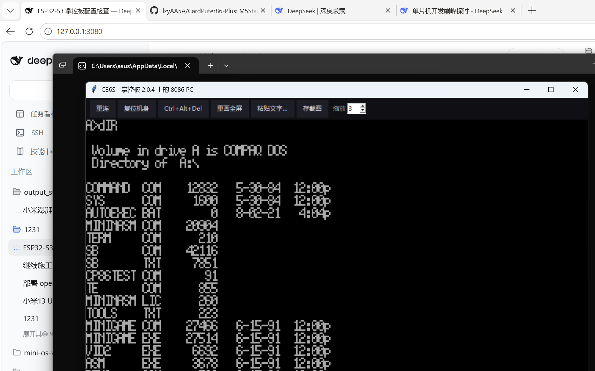

# C86S —— 适合 ESP32 的 DOS 模拟器（画面走串口）

> **中文** | [English](README.en.md)

在一块**裸 ESP32**（掌控板 2.0.4 / ESP32-D0WDQ6 / 8 MB flash / 无 PSRAM / 无屏幕）上跑
**8086 PC 与 MS-DOS**：板子只负责 CPU、内存和外设，**画面从串口推给电脑**，键盘从电脑发回板子。
电脑端一个窗口当显示器，插上 USB 就是一台 4.77 MHz 级的 PC/XT。

```
   ┌────────────────────┐   UART0 921600 (CP2104)   ┌──────────────────────┐
   │  掌控板 ESP32      │ ─────  视频帧 (RLE) ────► │  tools/c86host.py    │
   │  ESP32-D0WDQ6      │ ◄────  扫描码 / 命令 ──── │  320x200 窗口 + 键盘  │
   │  8MB GD25Q64       │                           │  ＋状态栏 / 截图      │
   └────────────────────┘                           └──────────────────────┘
```



## 它是什么

C86S 是 [CardPuter86](https://github.com/Clearwavelet/CardPuter86) 的一次**移植**：
模拟器内核沿用 Fake86 血统（见[许可证](#许可证与来源)），我们重写的是**机器层**——
原来那层是 M5GFX 屏幕 + Cardputer 键盘矩阵 + FatFS 镜像 + I2S 喇叭，现在换成串口视频、
PS/2 扫描码、裸 flash 分区和 BEEP 帧。

| 原来（Cardputer / ESP32-S3） | 现在（裸 ESP32） |
| --- | --- |
| LGFX sprite → ST7789 240x135 | 4bpp 打包 + 逐行 RLE → UART0 |
| Cardputer 键盘矩阵 | 电脑发来的 PS/2 set-1 扫描码 → 模拟 8042 |
| FatFS + 磨损均衡里挂 IMG 文件 | 裸 flash 分区当磁盘（不经过文件系统） |
| I2S 喇叭 | BEEP 帧，电脑侧发声 |
| TFT 上的设置菜单 | 电脑端窗口的按钮 |

好处很直接：卸掉 M5GFX / WiFi / BLE 之后，**固件从 2.0 MB 掉到 403 KB，静态 RAM 96 KB**，
省下来的全部留给客机内存页缓存。

## 实测数据

测试环境：掌控板 2.0.4（ESP32-D0WDQ6 V3 / 8 MB GD25Q64 / 240 MHz / 无 PSRAM），COM3 @ 921600。

| 项 | 实测值 |
| --- | --- |
| 固件体积 | 403,381 B（3 MB app 分区的 12.8%；用本仓库源码重建为 403,773 B） |
| 静态 RAM | 96,040 B（320 KB 的 29.3%） |
| 客机内存 | 256 KB（64 页，32 页常驻缓存，其余换到 flash） |
| 开机（复位 → `A:\>`） | **24.3 秒**（POST 内存测试 12 s + DOS 5.0 引导 8 s） |
| 指令吞吐 | **约 27 万条/秒**（2000 条一批 5.6 ms，≈672 周期/条） |
| 满屏文字一帧 | 32,000 B 原始画面 → 6.9 KB（4bpp + RLE） |

没有 PSRAM 是这块板最大的约束：客机 256 KB 内存切成 64 个 4 KB 页，常驻页缓存只放得下 32 页，
剩下的每淘汰一次就是一次「擦 + 写 4 KB」，约 48 ms。**开机慢的那 12 秒不是模拟器慢，是分页在搬**。
换成 128 KB 客机内存（`-DG86_FORCE_RAMKB=256` 改成 `128`）就没有换页，开机可以压到 5 秒级，
但 DOS 5.0 需要 256 KB —— 这是速度与系统的取舍，不是 bug。

## 快速开始

需要一台 Windows 电脑、PlatformIO，以及**你自己准备的一个 DOS 软盘镜像**（见下文「关于系统盘镜像」）。

```powershell
# 1. 编译
pio run -e c86s

# 2. 刷机（会先把整片 flash 备份到 backup\，再擦 swap 分区、写 bootloader/分区表/固件/系统盘、硬复位）
.\flash.ps1 -Port COM3

# 3. 开窗口（电脑端显示器 + 键盘）
python tools\c86host.py --port COM3 --scale 3
```

不想开窗口的话可以直接双击 `start-c86s.cmd`，它会拉起 `tools/c86mgr.py` 图形管理器：
一键启动 / 一键烧录 / 虚拟软盘编辑都在里面。

窗口里：上方按钮（重连 / 复位机身 / Ctrl+Alt+Del / 重画全屏 / 粘贴文字 / 存截图 / 缩放 1-4 倍），
中间是 320x200 画面，下方是板子日志，最下面是状态栏（fps、客机内存、堆、TEXT/GFX、丢帧、坏帧数）。

**电脑端不需要装任何 Python 包**：串口走 `ctypes` 直接调 Win32 API，画面走 tkinter + 自写 PNG 编码
（zlib 是标准库）。那种「pip install 到一半失败」的环境也能跑。

### 换系统盘

系统盘就是一个裸扇区分区（`disk` @ `0x600000`，2 MB）。换盘 = 把另一个 img 写进去：

```powershell
esptool --port COM3 --baud 921600 write-flash 0x600000 data\cardputer86.img
```

几何参数（每道扇区数、磁头数、每扇区字节数）从镜像自己的 BPB 读，**不用改代码**：
360 KB 盘自动按 40/2/9 走，1.44 MB 盘自动按 80/2/18 走。

## 硬件与分区

app 分区给到 3 MB，是因为模拟器把 BIOS / video ROM / 字库等约 1 MB 的数据编译进了 `.rodata`。

```
# name,     type, subtype,  offset,   size,     flags
nvs,        data, nvs,      0x9000,   0x5000,
otadata,    data, ota,      0xE000,   0x2000,
app0,       app,  factory,  0x10000,  0x300000,
swap,       data, 0x40,     0x310000, 0x90000,
disk,       data, 0x99,     0x600000, 0x200000,
```

`0x3A0000`-`0x600000` 留空不分——那块区域在原厂固件里是一段 GUIX 资源，不属于本工程，**不去动它**。
`swap` 是客机内存的换页后备区；`disk` 就是系统盘。

**flash 模式必须是 DIO**：这块板用 QIO 会进 `rst:0x7 (TG0WDT_SYS_RST)` 黑屏循环，`platformio.ini` 里已经锁死。

## 串口协议

一条 UART 上双向复用，921600 8N1：

* **下行（板 → 电脑）**：4bpp 打包的 320x200 画面，**逐行 RLE**（`<0x80` 是字面量跑、`>=0x80` 是重复跑），
  每行再叠一层「刷新代 + 内容签名」去重——没变的行一个字节都不发。
* **上行（电脑 → 板）**：PS/2 set-1 的 make/break 扫描码，板子拿它喂模拟的 8042 键盘控制器；
  另外还有复位、Ctrl+Alt+Del、粘贴文字等控制命令。

细节见 [`src/serial/proto.h`](src/serial/proto.h) 和 [`docs/PORTING-zh.md`](docs/PORTING-zh.md)。

## 关于系统盘镜像（重要）

**本仓库不附带任何 DOS 磁盘镜像。** 这样做是版权原因：MS-DOS / PC-DOS / Compaq DOS 的系统盘
是各自权利人的作品，不能再分发。

请自备一个可引导的 DOS 软盘镜像，按上面「换系统盘」的方式写进 `0x600000` 即可。
如果你手上有正版 DOS 软盘镜像，直接用它；想要完全自由授权的组合，可以用 FreeDOS 做一张 1.44 MB 启动盘。

同理，本仓库也**不含**任何厂商固件备份（板上原厂固件是别人发的，不是我们的东西）。

## 已知限制

* **必须带一台电脑当显示器**：这块板没有屏、没有键盘，脱离电脑就是一块空板。
* **约 27 万条指令/秒**：相当于 4.77 MHz 的 IBM PC/XT。跑 1981-1985 年的 DOS 软件没问题，
  跑后期的动作游戏会吃力。
* **客机内存 256 KB**：没有 PSRAM，再往上就要频繁换页。
* **开机 24 秒**：其中 12 秒是 POST 在扫内存触发换页，属于这套硬件方案的固有代价。
* 首次刷机会先整片备份（2-3 分钟），之后再刷可以加 `-SkipBackup` 跳过。

## 目录

```
platformio.ini          编译配置（DIO / 8MB / 分区表 / 优化开关）
partitions_c86s.csv     分区表
flash.ps1               命令行烧录（备份 → 擦 swap → 写固件 → 写系统盘 → 硬复位）
start-c86s.cmd          双击启动图形管理器
src/main.cpp            固件主程序（板级初始化 + 主循环）
src/serial/             机器层：串口视频链路、PS/2 键盘、存储、BEEP、RTC
src/emu/                模拟器内核（Fake86 血统，含本移植对分页/配置的改动）
tools/c86host.py        电脑端显示器 + 键盘（无第三方依赖）
tools/c86mgr.py         图形管理器：一键启动 / 一键烧录 / 虚拟软盘编辑
tools/fat12.py          虚拟软盘读写（FAT12）
docs/PORTING-zh.md      移植交付说明：踩过的坑、测过的东西、为什么这么设计（中文）
```

## 许可证与来源

本项目以 **GNU GPL v3.0 或更高版本**发布，详见 [LICENSE](LICENSE)；第三方组件的来源与许可见 [NOTICE.md](NOTICE.md)。

血统链条（全部保留原始署名）：

* **Fake86** —— 8086 PC 模拟器，by Mike Chambers
* **ESP32TinyFake86** —— ESP32 移植版，by Ackerman
* **CardPuter86** —— M5Stack Cardputer（ESP32-S3）版本，Copyright (C) 2026 Clearwave，GPL-3.0-or-later
* **C86S** —— 本项目：把它搬到裸 ESP32 上，画面改走串口

因为上游是 GPL-3.0-or-later，C86S 作为衍生作品同样以 GPL-3.0-or-later 发布；
`src/emu/` 中与上游不一致的文件（分页、配置、端口、渲染等）一并在本仓库提供完整源码。
